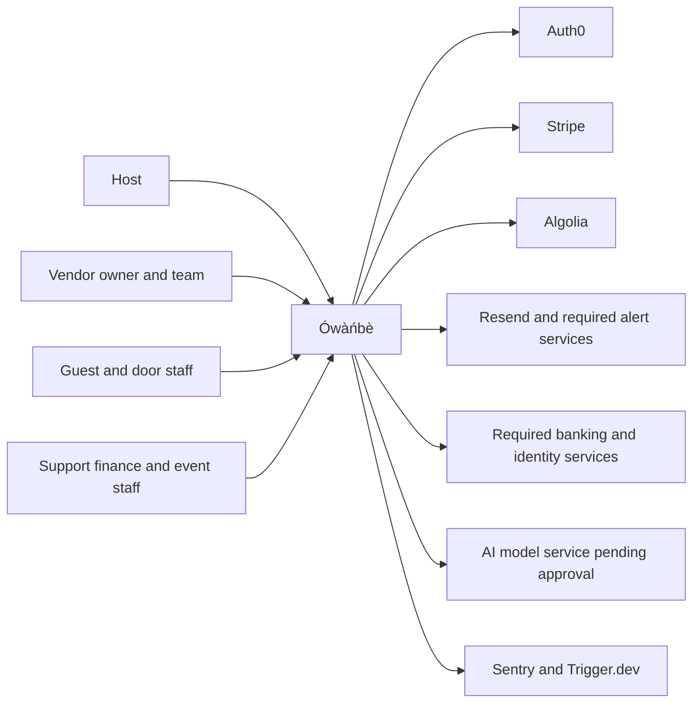
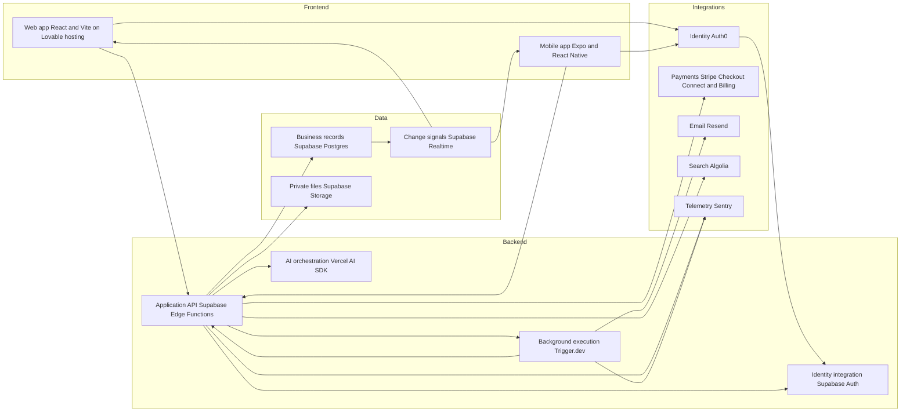
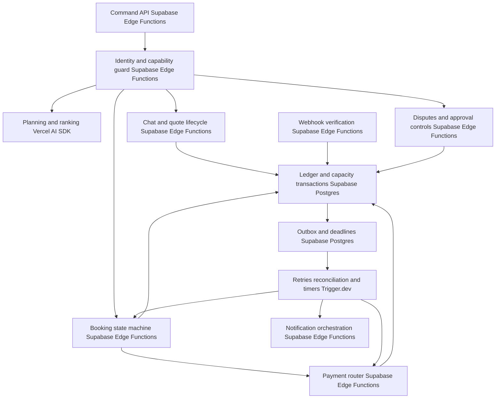
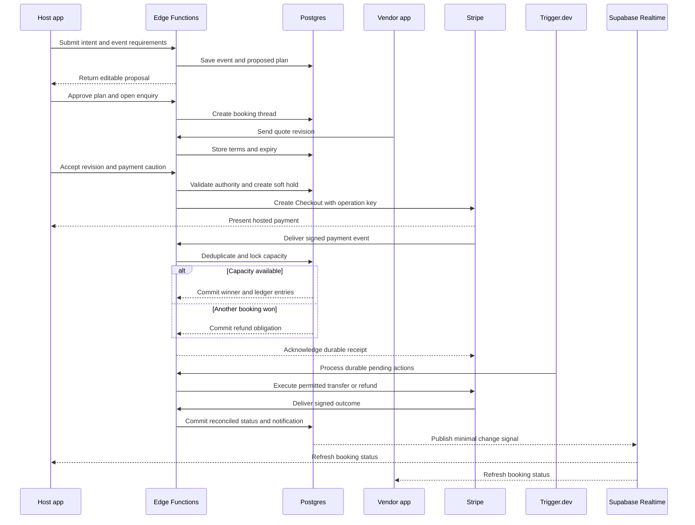

Generated by Sage 7 on 2026-11-12. Edit in Sage 7.

# Ówàńbè Architecture

## Overview

Ówàńbè is a celebration-commerce and event-operations platform connecting hosts, vendor businesses, guests, and platform staff. Its shared Supabase backend serves a React + Vite web application and Expo mobile application. The core workflow turns event intent into an editable plan, vendor enquiry, negotiated quote, approved payment, confirmed booking, and completion or dispute resolution. Auth0 provides identity; server-enforced permissions separate Host and Vendor houses. Postgres owns business state and financial records; AI proposes and investigates but cannot approve commitments or move money.

**Architecture assumptions and launch gates**

- **Assumption:** Fewer than 50,000 users in year one. Hosts cannot delegate workspace administration; narrowly scoped guest-list sharing is not delegation.
- **Stack boundary:** Only decided technologies are selected below. Required banking, verification, messaging, scanning, and model-provider capabilities without approved suppliers remain **blocked dependencies**, not silently substituted technologies.
- **Payment gate:** Stripe eligibility, Connect capabilities, licensed custody arrangements, banking connectivity, and backup processing must be confirmed. Stripe alone does not establish the required proprietary bank-routing or wallet capability.
- **Policy conflict:** Quote date locks conflict with concurrent soft holds. Proposed interpretation: sent quotes reserve a non-exclusive opportunity; only a confirmed payment creates an exclusive capacity allocation. Product approval is required.
- **Assumption:** One bookable capacity unit per vendor per date initially. Event time zone and service end time must be explicit.
- **Safety gate:** Immediate 70% release conflicts with full refunds and host cancellation refunds. Reserves, recoverability, fees, and funding responsibility require approved commercial and legal policies.
- Health processing, AI sensitive-data processing, upload scanning, biometric verification, and regulated payments remain disabled until their contractual and technical gates pass. This architecture does not claim ASVS Level 3 certification.

## Level 1 — System context

External services are outside the product trust boundary. Required alert, banking, identity, and AI services are capability requirements from the feature map; unresolved providers are launch blockers.

## Level 2 — Containers

The AI module runs inside approved backend execution paths, not as a separate hosting platform. Trigger.dev handles durable orchestration; Postgres remains authoritative for deadlines, retries, and job outcomes. Supabase Auth integrates external identity rather than creating a competing user-password system.

## Level 3 — Components

Core booking workflow components are logical modules, not separate microservices.

All monetary transitions use one state-machine implementation. Worker callbacks use narrow service permissions and cannot bypass approval, dispute, recovery-lock, or payout-freeze checks.

## Request flow

Checkout return URLs never confirm bookings. “First payment wins” means the first valid success event that commits the serialized capacity allocation; product must approve this definition because provider timestamps and delivery order can differ. Unknown payment outcomes trigger reconciliation, not a second charge.

## Frontend

### Routes and screens

Web and mobile share route concepts and server contracts:

| Area | Routes or screens |
| --- | --- |
| Entry | Sign-in, identity-limited onboarding, intent capture, become a vendor |
| Host | `/host`, event plan, budget, providers, shortlist, chat, quotes, payment tracker |
| Event operations | Guests, invitations, schedule, completion, dispute, cancellation |
| Vendor | `/vendor`, enquiries, calendar, quote builder, service catalogue, trust score |
| Vendor settings | Team capabilities, payout verification, subscriptions |
| Shared | House switcher, notification centre, preferences, data rights |
| Staff | Verification queue, restricted support cases, disputes, approvals, assignments, monitoring |
| Guest mobile | Invite claim, VIP card, entry scanning |

Deep links resolve the target house and require confirmation before switching. Unread counters remain separate by house. Vendor profiles use one schema with progressively exposed tools.

### State

- React state holds forms, optimistic drafts, and navigation; server responses own permissions, money, quote revisions, and deadlines.
- Offline mobile writes are limited to drafts and queued check-in observations. Payments, quote acceptance, invitation reissue, and permissions require connectivity.
- Check-in devices cache minimal admission data without health information, addresses, or phone lists. QR and NFC support require device validation.
- Offline scanners cannot guarantee global duplicate-admission prevention. Define device allocation and conflict procedures before rollout.
- Realtime sends minimal invalidation signals; clients fetch authorized records. Reconnect performs version-based catch-up.
- Display verified availability, benchmark provenance, and AI uncertainty. Thin-market dashboards offer broader searches and planning actions, never invented vendors.

## Backend

### Services and server functions

- **Identity and houses:** Resolve Auth0 subject to internal user; validate active membership, house, capability, and current revocation version.
- **Planning:** OwanbePlanner and OwanbeAI use Vercel AI SDK with provider configuration isolated from product logic. Retrieve permitted listings and curated benchmarks; validate generated proposals before saving.
- **Commerce:** Maintain enquiries, structured counters, vendor-authored quote revisions, bookings, availability, and completed-booking review eligibility.
- **Payment Router:** Coordinate tokenized partner operations, balanced ledger entries, payment attempts, fees, refunds, and reconciliation. It is application logic, not a licensed bank.
- **Operations:** Cases, scoped event-manager assignment, verification decisions, appeals, recovery, emergency replacements, and staff approvals.
- **Access and content:** Consent, revocable sharing, invitation claims, private evidence delivery, moderation, exports, and deletion.
- **Trust:** Derive scores from versioned rules and immutable booking facts. Administrators cannot override deductions.

Every command carries an operation identifier and expected record version. Monetary actions additionally bind approvals to amount, currency, beneficiary, action, and immutable terms.

### Background jobs

Trigger.dev processes transactional outbox records and scheduled sweeps for:

- Quote expiry, accepted-quote payment windows, reminders, and unanswered enquiries.
- Verification escalation after 24 hours; escalation does not imply approval or automatic fund release.
- Completion prompts and 30% release after the approved 24-hour silence period, provided no dispute or freeze exists.
- Losing-payment refunds, reconciliation, recovery holds, subscription grace periods, downgrades, and receipts.
- Notification fallback, search indexing, retention deletion, exports, and weekly/monthly decision reviews.

Timers store durable due times. Outage intervals pause affected payment windows automatically; resumed deadlines account for elapsed paused time. Retry jobs recheck current state, not the original snapshot.

**Unresolved policy gates:** dispute-window anchor, payments pending at expiry, large-action threshold, verification fund holds, cancellation fees, and recovery funding. Until thresholds are approved, all manual fund actions require two distinct authorized staff approvals. Automated losing-bid refunds require an explicitly approved standing policy.

## Database

### Tables and key fields

All business records use stable identifiers, timestamps, and versions. Monetary amounts use integer minor units and explicit currency.

| Tables | Key fields |
| --- | --- |
| `users`, `houses` | `id`, `auth0_subject`, `owner_id`, `house_type`, `recovery_locked_until` |
| `memberships`, `sessions` | `house_id`, `user_id`, `capabilities`, `revoked_at`, `authz_version` |
| `events`, `plans`, `tasks` | `host_house_id`, `intent`, `timezone`, `starts_at`, `ends_at`, `budget`, `revision`, `status` |
| `vendors`, `services`, `benchmarks` | `vendor_house_id`, `verification_status`, `category`, `location`, `price`, `source`, `observed_at` |
| `shortlists`, `threads`, `messages` | `event_id`, `host_house_id`, `vendor_house_id`, `author_id`, `body`, `deleted_at` |
| `quotes`, `quote_lines` | `thread_id`, `revision`, `terms_hash`, `amount`, `currency`, `expires_at`, `status` |
| `bookings`, `capacity_slots`, `soft_holds` | `quote_id`, `vendor_house_id`, `service_date`, `capacity_unit`, `winner_booking_id`, `payment_deadline` |
| `payment_attempts`, `provider_events` | `booking_id`, `operation_key`, `provider_reference`, `provider_event_id`, `status` |
| `ledger_accounts`, `ledger_transactions`, `ledger_entries` | `owner_id`, `currency`, `business_key`, `account_id`, `debit`, `credit` |
| `fund_actions`, `approvals` | `booking_id`, `action_hash`, `amount`, `initiator_id`, `approver_id`, `status` |
| `outage_intervals`, `reconciliations` | `capability`, `started_at`, `ended_at`, `provider_reference`, `difference`, `resolution` |
| `cases`, `case_evidence`, `case_updates` | `booking_id`, `type`, `visibility`, `freeze_status`, `storage_path`, `public_status` |
| `verification_cases`, `verification_decisions` | `subject_id`, `provider_reference`, `deadline`, `decision`, `rationale`, `reviewer_id` |
| `staff_assignments`, `access_grants` | `user_id`, `event_id`, `resource_id`, `scope`, `expires_at`, `revoked_at` |
| `guests`, `guest_health`, `consents` | `event_id`, `guest_id`, `restricted_contact`, `dietary_details`, `consent_version`, `delete_after` |
| `invitations`, `invite_claims`, `checkins` | `token_hash`, `claim_limit`, `generation`, `phone_binding_reference`, `device_id`, `status` |
| `notifications`, `deliveries`, `preferences` | `user_id`, `house_id`, `category`, `channel`, `attempt`, `status`, `marketing_consent` |
| `subscriptions`, `reviews`, `trust_events` | `house_id`, `provider_reference`, `grace_until`, `booking_id`, `rating`, `deduction` |
| `files`, `moderation_reports`, `ai_reports` | `owner_house_id`, `classification`, `scan_status`, `storage_path`, `review_status` |
| `jobs`, `outbox`, `audit_events`, `data_requests` | `operation_key`, `due_at`, `attempt`, `actor_id`, `resource_id`, `reason`, `status` |

### Access rules and invariants

- Enable RLS on every exposed table; default deny. Membership is checked from current database state, not trusted solely from token claims.
- Booking and conversation access explicitly permits their host and vendor parties; unrelated records remain house-isolated.
- Support can read authorized chats but not financial details or health records. Event managers see approved fields for assigned events only.
- Raw no-show tickets and evidence are support-only. Hosts receive a sanitized progress projection; vendors submit evidence through a separate restricted surface.
- Dietary information is separated from guest identity and limited to the host and assigned caterer under valid consent. Public guest views never expose addresses or phone numbers.
- Ledger journals balance per currency and are append-only to application roles. Corrections use compensating entries. Cached balances are rebuildable.
- Unique provider-event and business-operation keys prevent duplicate effects. Capacity allocation and booking transitions execute in one database transaction.
- Private Storage access uses matching authorization; sensitive downloads pass through checked server functions.
- Invite claim limits are enforced atomically. Reissue changes token generation and invalidates previous claims.

## Integrations

| Service | Purpose | What breaks if it goes down | Fallback |
| --- | --- | --- | --- |
| Auth0 | Login, MFA, enterprise SAML or OIDC | New sessions and step-up checks | Existing valid sessions remain policy-checked; sensitive actions wait |
| Supabase | Data, functions, storage, realtime | Core reads/writes or individual capabilities | Cached read-only screens; no financial offline writes |
| Stripe | Checkout, Connect, Billing | Payments, transfers, refunds, renewals | Reconcile unknown outcomes; pause payment windows during full outage |
| Trigger.dev | Durable jobs and timers | Expiry, releases, retries | Persist obligations; alert and sweep overdue jobs after recovery |
| Resend | Receipts and marketing email | Email delivery | In-app notices; queued retries; required alert channels when approved |
| Algolia | Public vendor discovery | Ranked search | Bounded Postgres category and location queries |
| Vercel AI SDK | Provider-neutral AI interface | AI planning or investigation | Manual planning and staff investigation |
| AI model provider — unresolved | Model inference | AI features cannot launch | Manual workflows; contract and ZDR gate |
| Banking and backup processing — unresolved | NIBSS, open banking, partner custody, failover | Required wallet and routing features | No claim of support; payment launch gate |
| Identity services — unresolved | CAC, NIMC, NIN and BVN verification | Verification remains pending | Limited signup and Unverified badge; authorized manual review |
| WhatsApp and SMS — unresolved | Default and critical alerts | Mandatory channel coverage | In-app and Resend; unmet requirement remains explicit |
| Upload scanning — unresolved | Malware assessment | Upload publication and evidence access | Quarantine; file-type checks alone are insufficient |
| Sentry | Errors, performance, alerting | Diagnosis and on-call visibility | Operational records and backlog dashboard remain available |

A backup processor must never retry a transaction with an unknown primary outcome. Partner-bank outages may prevent both primary and backup processing.

## Auth & security

- **Identity integration gate:** Validate supported Auth0 token verification with Supabase, including issuer, audience, subject mapping, and RLS claims. Until proven, protected access remains server-mediated; never assume Auth0 tokens automatically work across Supabase services.
- Auth0 owns interactive identity and MFA. Payout changes require owner authority, fresh MFA, and no recovery lock; financial partners retain bank credentials.
- Every write checks server-side capabilities. Sensitive reads are also mediated and audit-logged. Administrative keys never reach clients.
- Team removal revokes server sessions and memberships immediately. Realtime carries no protected business content; subsequent reads fail immediately. Previously viewed information cannot be remotely erased.
- Use encrypted transport and storage, least-privilege secrets, restrictive web policies, rate limits, signed webhooks, replay protection, and security-focused automated tests.
- AI has no payment mutation credentials. Its investigation tools expose redacted, read-only payment status. Financial evidence is never treated as an instruction.
- Health processing requires explicit consent, approved retention, required BAAs, and the applicable Supabase plan/add-on. Do not send health data to email, search, telemetry, or ordinary job payloads. ZDR alone is not a BAA.
- All uploads remain quarantined until approved scanning succeeds. Identity-document deletion must reconcile legal retention obligations before activation.
- NDPA and GDPR/UK-GDPR workflows support export, deletion, consent withdrawal, and transfer disclosures. “Never delete payment records” requires legal retention review and identity minimization.
- Payout recovery imposes the required 48-hour lock. Trusted-partner recovery and face scanning remain gated; neither weak nickname knowledge nor unapproved biometrics replaces strong verification.
- ASVS Level 3 verification includes cross-house RLS tests, staff field restrictions, revoked sessions, race conditions, webhook replay, and independent security assessment.

## Observability & error handling

Sentry receives scrubbed errors and performance traces with correlation IDs, operation IDs, and non-sensitive state transitions. Disable sensitive payload capture and recording. Do not include chat bodies, guest details, identity documents, credentials, or payment tokens.

Track payment reconciliation differences, webhook lag, outbox age, overdue timers, refund backlog, verification SLA breaches, notification failures, and search freshness. The monitoring dashboard reads operational records; an assigned on-call owner and tested alert delivery are launch requirements.

Use bounded retries with backoff. Exhausted jobs create a failure record, notify operations, and require an audited rerun. Money-related reruns preserve original idempotency keys and approvals. User-facing failures distinguish **pending**, **failed**, and **unknown**; never show a refund as completed merely because it was requested.

## Scaling notes tied to quality drivers

- **Security:** Partition access by house and relationship; index policy lookup fields. Run authorization regression tests on every schema change.
- **Performance efficiency:** Target under one second for committed updates reaching connected clients. Measure database-to-client latency separately from external payment completion. Paginate, limit subscriptions, compress images, and lazy-load heavy screens for slow 4G.
- **Reliability:** Durable outbox, serialized capacity allocation, idempotent fund actions, reconciliation, and tested restore procedures prevent silent loss. Recovery objectives require business approval.
- **Flexibility:** Web and mobile share commands and policies. Model switching changes provider configuration and contract validation, not business logic. Prefer a suitable African region when available; verify every service’s residency independently.
- **Safety:** Approval-bound actions, dispute freezes, visible confirmations, and reversible drafts protect users. Settled money cannot be “undone” without a compensating financial action.
- **Compatibility:** Test Auth0 enterprise sign-in, Expo guest flows, device scanning, and reconnect behavior before rollout.
- **Maintainability:** Keep a modular backend rather than premature service separation. Monitor Algolia query costs, Trigger.dev trial suitability, Auth0 costs, and the SPA’s public-search visibility limitation.

## Dependency impact list

- **If Auth0 breaks,** login and fresh MFA are affected.
- **If Supabase Postgres breaks,** authorization, bookings, financial state, and job progress are affected.
- **If Edge Functions break,** protected commands and webhook intake are affected.
- **If Supabase Realtime breaks,** live updates are affected; authorized refresh remains available.
- **If Supabase Storage or scanning breaks,** uploads and evidence review are affected.
- **If Stripe or required banking partners break,** payments, releases, refunds, and reconciliation are affected.
- **If Trigger.dev breaks,** timed obligations accumulate; they must not be considered completed.
- **If Algolia breaks,** discovery quality is affected, not confirmed bookings.
- **If AI inference breaks,** recommendations and automated investigation are affected, not manual commerce.
- **If notification providers break,** external alerts are affected; in-app notices remain durable.
- **If verification services break,** onboarding remains limited and vendor verification stays pending.
- **If Sentry breaks,** diagnosis and alert visibility are affected, not transactional correctness.
- **If unresolved compliance or policy gates remain open,** the corresponding must-have features cannot be represented as launch-ready.