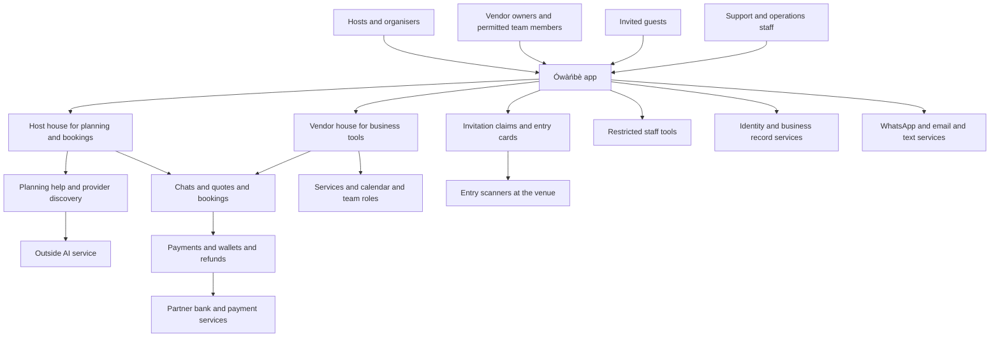
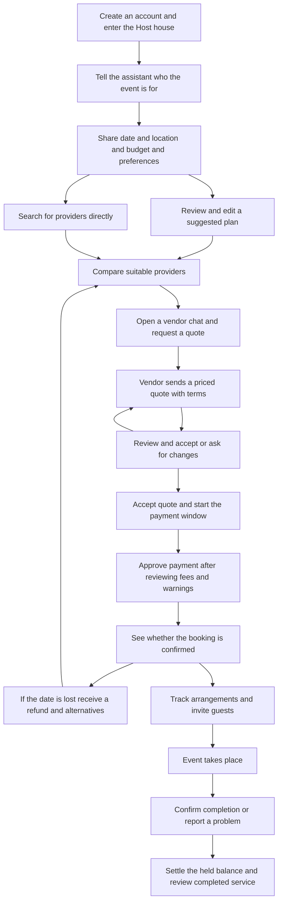
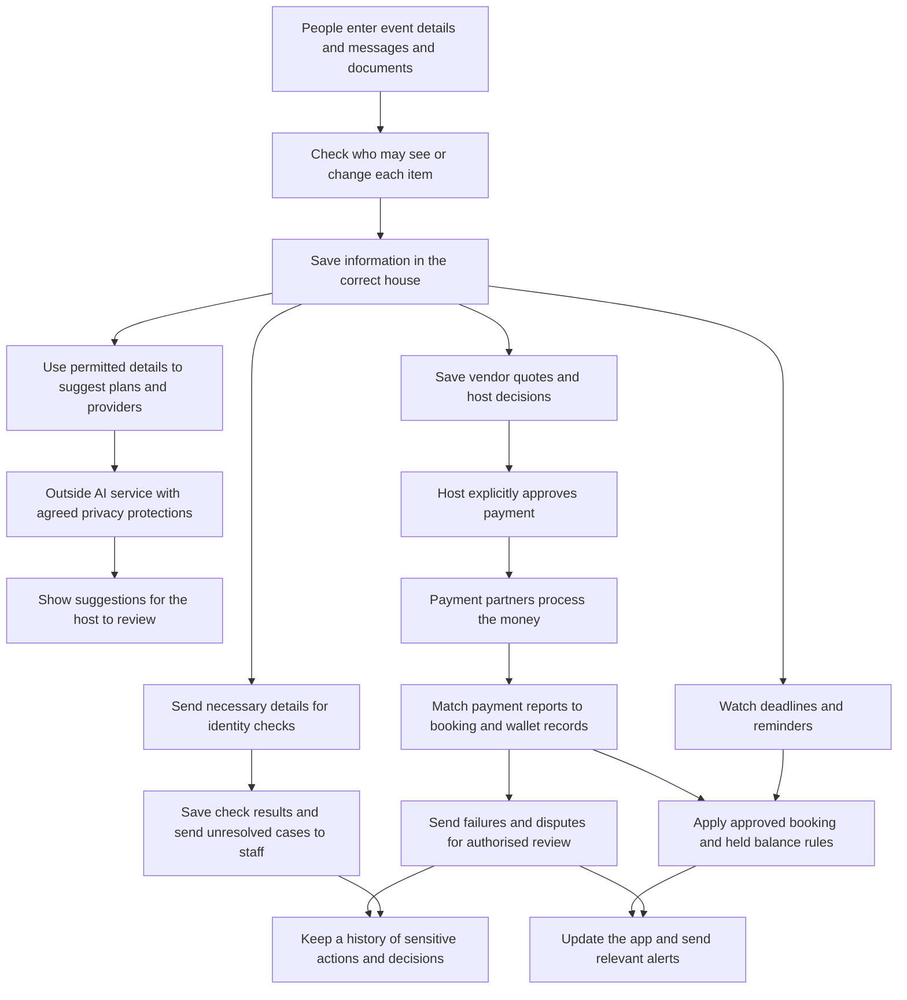

Generated by Sage 7 on 2026-11-13. Edit in Sage 7.

# System Overview

## 1. What Ówàńbè does

Ówàńbè is a proposed platform for planning Nigerian celebrations and coordinating the people and services that bring them to life. Hosts describe their event, budget and preferences, then get help building a plan, comparing providers, discussing quotes, paying and managing arrangements. Vendors use the same app to showcase their services, answer enquiries, prepare quotes and manage bookings and their teams. Guests can claim invitations and use an entry card at the venue. AI [software that generates suggestions from information] supports planning and helps investigate problems, but does not approve commitments or move money. The aim is to reduce the administrative burden of celebrations while respecting cultural and family differences, supporting vendors’ businesses and keeping hosts in control. The overview below describes the intended product, not a claim that these services or safeguards are already live.

## 2. The big picture

- **One app serves different people.** A person can have both a Host house and a Vendor house [separate work areas], with their information kept apart. Alerts do not switch them between houses without confirmation.
- **Hosts remain responsible for decisions.** They choose providers and approve quotes and payments. Hosts cannot delegate account authority; vendor owners can give their own team members limited responsibilities.
- **Vendors have one business home.** They can use it lightly for a profile and enquiries, or more fully for quotes, calendars, bookings and team management. Only the owner can change payout details.
- **Outside services support essential work.** Banking partners handle payment credentials, official record services support identity checks, and messaging services deliver alerts. Identity checks are not a guarantee of service quality.
- **Guests and staff have narrower access.** Guests claim entry cards without needing a full account. Support can read host–vendor chats but not payment details; assigned event managers see only their assigned events, and sensitive access is recorded.

The intended commercial model combines vendor monthly subscriptions with host transaction and planning fees. The exact charging model for the planning assistant still needs a decision. Fees and cancellation terms should be clear before anyone commits.

## 3. How a user moves through it

The main journey follows a host from an event idea to a completed booking. Direct search is also available for hosts who already know what they need.

- **Planning starts with the host’s intent.** The assistant asks whether they are hosting their own event or arranging services for someone else. Suggestions should reflect their budget, location and preferences rather than assume every family celebrates alike.
- **The vendor writes the quote.** The host can negotiate in chat, but only the vendor can issue a revised quote. Revised quotes restart the proposed 24-hour quote expiry period.
- **Accepting is not the same as securing the booking.** Acceptance starts a 24-hour payment window. Under the proposed shared-date rule, competing hosts are warned, the first confirmed payment wins, and a losing payment is refunded with a receipt and alternatives.
- **Payment terms matter before approval.** The proposed split releases 70% to the vendor at booking and holds 30%. Host cancellation is allowed only within 24 hours of payment and forfeits 20% of the full quote price; vendor cancellation after payment triggers a full host refund.
- **Completion includes a chance to raise problems.** The remaining 30% releases after host confirmation or after the proposed 24-hour silence period. A timely dispute freezes that balance for review. A no-show also triggers support and urgent replacement recommendations; recovering money already released is not guaranteed.

For invitations, guests download the app and claim a link tied to their phone number. A standard link permits one claim; a couple’s link permits two. Their entry card is scanned or tapped at the venue. Door staff admit confirmed guests rather than change invitation ownership.

**Booking rules to settle before launch:** The brief describes both a date lock when a quote is sent and competing hosts during a later temporary hold. Those rules need one consistent explanation. The precise starting point for the post-event dispute and automatic-release deadlines also needs to be defined so users cannot lose their opportunity to report a problem unexpectedly.

## 4. What happens behind the scenes

The app keeps the plan, conversations, quotes and payment status connected so that both sides can see what has happened and what needs attention.

- **Information follows permission rules.** Host and vendor records stay separate. Guest lists are private by default, and phone numbers and addresses remain hidden when lists are shared. Allergy information requires explicit consent, is restricted to the host and assigned caterer, and is scheduled for deletion after the event.
- **AI provides assistance, not authority.** It suggests plans and can investigate payment failures using read-only records. It cannot approve spending, release funds or grant access to private information. Sensitive information may go only to an AI provider contractually committed not to retain it or use it for training.
- **Payment partners handle sensitive financial details.** Ówàńbè keeps wallet balances and transaction records, not raw card or bank credentials. It checks partner reports against bookings so a payment is not treated as successful merely because someone clicked Pay.
- **Automatic checks keep work moving.** They manage quote expiry, payment windows, reminders, held balances and subscriptions without duplicating charges or releases when retried. A backup payment processor supports continuity; a complete payment outage pauses the payment window and alerts both parties.
- **Problems reach people with the right authority.** Failed payments and overdue tasks trigger investigation and staff alerts. Large refunds and large manual payment-related reruns require two approvers. Important messages remain in the app, with WhatsApp and email delivery plus text messages for critical events.

### Important safeguards and launch decisions

**Money handling must be legally established.** The partner bank and permitted arrangement for holding and routing host funds are not yet confirmed. Wallets, the 70/30 payment split, refunds and replacement funding depend on that arrangement. The amount that counts as a “large” financial action also needs to be set.

**Verification needs clear limits.** The intended process checks Nigerian identity and banking records and vendor business registration. If an outside verification service is unavailable, new users receive limited access and vendors display an Unverified badge. The exact access limits and the evidence required to pass verification remain undecided. Unresolved vendor checks should reach manual review within the proposed 24-hour limit; treatment of held money beyond that point needs clarification.

**Emergency recovery needs real operational capacity.** A no-show should immediately surface available, vetted alternatives, with an in-house event manager as the intended fallback. The proposed platform advance of 50% of a replacement booking requires human approval and an adequately funded arrangement. Availability and staffing must not be presented as guaranteed before they are established.

**Privacy promises need consistent retention rules.** Users should be able to access, export and request deletion of their information. The proposed permanent financial records and deletion of identity documents after verification must be reconciled with legal retention duties. Any required financial records should retain only the personal information legally necessary.

**Cultural guidance needs community review.** Validate the name’s spelling and tone marks with qualified Yoruba specialists before launch. Planning advice should acknowledge regional, religious and family differences rather than present one version of a celebration as universally correct.